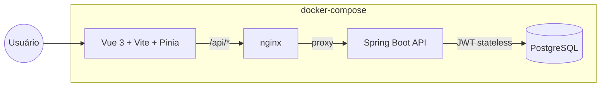

# gestor-de-tarefas-kanban

Quadro Kanban colaborativo: organize tarefas em colunas, com arrastar e soltar, prazos, etiquetas e vários usuários por quadro, cada um com um papel (dono, editor ou leitor).

## Funcionalidades

- Cadastro e login com JWT (access token curto + refresh token opaco e rotativo)
- Criação de quadros, colunas e cartões, com permissões por papel (DONO, EDITOR, LEITOR)
- Arrastar e soltar entre colunas, com a ordem salva no servidor sem reordenar a coluna inteira
- Convite de membros por e-mail, com escolha do papel
- Etiquetas coloridas por quadro, aplicáveis a cartões
- Filtros por etiqueta, responsável e prazo vencido

## Arquitetura



A autenticação é stateless: o access token (JWT, curta duração) carrega o id e nome do usuário nas claims, então requisições autenticadas não consultam o banco para resolver "quem é esse usuário". O refresh token é opaco (não é um JWT) — apenas o hash SHA-256 dele fica no banco, e cada uso rotaciona o token (o antigo é revogado e um novo é emitido), limitando o estrago de um token roubado.

Autorização por quadro usa três papéis hierárquicos (LEITOR < EDITOR < DONO). Toda ação sensível passa por `QuadroAuthorizationService`, que confirma a associação do usuário ao quadro e o papel mínimo exigido antes de prosseguir.

## Stack

| Camada | Tecnologia |
| --- | --- |
| Frontend | Vue 3, Vite, TypeScript, Pinia, Vue Router, Tailwind CSS, vuedraggable |
| Backend | Spring Boot 3, Java 21, Spring Security, Spring Data JPA, JJWT |
| Banco | PostgreSQL 16 + Flyway |
| Documentação da API | springdoc-openapi (Swagger em `/swagger-ui.html`) |
| Testes | JUnit 5, Testcontainers (Postgres), Vitest, Vue Test Utils |
| Infra | Docker Compose, nginx (proxy reverso + estáticos + SPA), GitHub Actions |

## Como rodar

Pré-requisitos: Docker e Docker Compose.

```bash
cp .env.example .env
docker compose up --build
```

- Frontend: http://localhost:8091
- API: http://localhost:8071 — documentação em http://localhost:8071/swagger-ui.html

As portas expostas no host (`BACKEND_PORT`, `FRONTEND_PORT`) podem ser ajustadas no `.env` caso já estejam em uso.

### Rodando os testes

```bash
# Backend — testes unitários + integração (Testcontainers, requer Docker)
cd backend
mvn verify

# Frontend
cd frontend
npm ci
npm run test
npm run build   # checagem de tipos + build de produção
```

## Decisões técnicas

- **Posição numérica com espaço entre valores**: colunas e cartões guardam uma posição decimal (ex.: 1000, 2000). Mover um item calcula o ponto médio entre os vizinhos na nova posição e grava só esse item — a coluna inteira nunca é reordenada, mesmo com muitos cartões.
- **Refresh token opaco e rotativo**: ao contrário de um JWT de longa duração, o refresh token não carrega informação alguma e só pode ser usado uma vez; cada troca invalida o anterior e emite um novo, o que limita o impacto de um vazamento.
- **Resposta de erro consistente em toda a API**: até as rejeições que acontecem no filtro de segurança do Spring (401 por falta de autenticação, 403 por papel insuficiente), antes de chegar ao `@RestControllerAdvice`, usam o mesmo formato JSON do restante da API, via um `AuthenticationEntryPoint` e um `AccessDeniedHandler` dedicados.
- **nginx como borda única**: um único domínio/porta serve o SPA (incluindo o fallback para `index.html` do Vue Router em modo history) e faz proxy de `/api/*` para o backend.

### O que este projeto demonstra

Spring Security com JWT de verdade (access + refresh, rotação, revogação), modelagem de autorização por papel e gerenciamento de estado no Vue com Pinia — fundamentos que aparecem em praticamente toda vaga Java/Vue.

## Roteiro (próximas evoluções)

- [ ] Atualização em tempo real via WebSocket quando outro membro mexe no quadro
- [ ] Comentários e histórico de atividades do cartão
- [ ] Notificação por e-mail de prazo próximo
- [ ] Modo escuro e uso no celular (PWA)
